# nvblox

GPU-accelerated volumetric mapping: fuse posed depth images into a TSDF on the
GPU, mesh it, and sweep a Euclidean signed distance field out of it for
planning. This demo runs nvblox standalone (no ROS) on the **egocentric RealSense
D435 stream of a Unitree G1** as it walks up to a chair and turns it, from the
Humanoid Everyday dataset.

- **Repo**: [nvidia-isaac/nvblox](https://github.com/nvidia-isaac/nvblox) (pinned to `v0.0.10`)
- **Paper**: [nvblox: GPU-Accelerated Incremental Signed Distance Field Mapping](https://arxiv.org/abs/2311.00626) — Millane, Oleynikova, Wirbel, Steiner, Ramasamy, Tingdahl and Siegwart, ICRA 2024
- Also relevant: [Voxblox](https://arxiv.org/abs/1611.03631) (Oleynikova et al., IROS 2017), the CPU predecessor whose ESDF this replaces — the `voxblox/` folder in this repo covers it
- **Dataset**: [Humanoid Everyday](https://humanoideveryday.github.io/) — [Humanoid Everyday: A Comprehensive Robotic Dataset for Open-World Humanoid Manipulation](https://arxiv.org/abs/2510.08807), Zhao, Jing, Liu, Mao, Jha, Yang, Xue, Zakharov, Guizilini and Wang, 2025 ([code](https://github.com/physical-superintelligence-lab/Humanoid-Everyday))
- **Dataset** (a bigger scene, online pipeline only): [TUM RGB-D](https://cvg.cit.tum.de/data/datasets/rgbd-dataset) `fr3/long_office_household` — A Benchmark for the Evaluation of RGB-D SLAM Systems, Sturm, Engelhard, Endres, Burgard and Cremers, IROS 2012

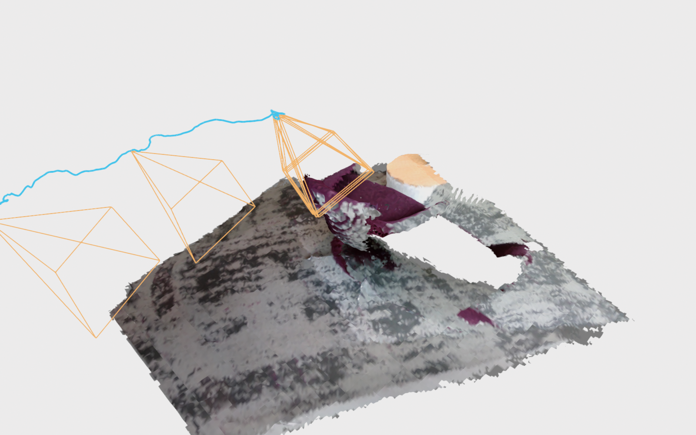

581 frames of head-camera RGB-D fused at 1.5 cm voxels. The armchair, the beige
stool and the pattern in the carpet all survive into the mesh; blue is the camera
trajectory 1.24 m above the floor, orange the frusta, and the bite out of the
carpet is where the chair stood before the robot turned it.

## What nvblox is, and what it needs

nvblox is the **mapping** half of a SLAM system, not the whole thing. It takes
depth images that already have poses and turns them into a TSDF, a mesh and an
ESDF; it has no tracker of its own. In the Isaac stack the poses come from
cuVSLAM (`../cuvslam/` in this repo). Here they come from the recording, and
where exactly is the interesting part — see [Poses](#poses-where-the-trajectory-comes-from).

Two pipelines here: the original one computes poses offline (depth ICP or the
robot's legged odometry) and then fuses; the second runs **cuVSLAM and nvblox
online, frame by frame** — see [Online SLAM](#online-slam-cuvslam--nvblox).

## Build

```bash
podman build -t slam_zero_to_hero:nvblox .
```

CUDA 12.8 is the floor, not a preference: sm_120 (GeForce RTX 50-series) only
exists from 12.8 onwards. The image compiles for sm_86, sm_89 and sm_120; trim
`--build-arg CUDA_ARCHS=89` to your own card to roughly halve the build. Verified
on an RTX 5090, driver 580.

## Download the dataset

```bash
python3 ../download_humanoid_everyday.py          # the demo's three tasks, ~1.1 GB
python3 ../download_humanoid_everyday.py --list    # all 259 tasks by category
python3 ../download_humanoid_everyday.py --category loco_manipulation
```

Everything lands in `~/data/humanoid_everyday/<task>/episode_N/`. The full dataset
is ~500 GB, so the script pulls one task at a time from the per-task links in the
upstream spreadsheet (259 tasks are listed there; upstream quotes 260).

The default is **`walk_towards_chair_and_rotate_the_chair`**, from the
`loco_manipulation` category — the one where the robot walks rather than standing
still. Each episode holds:

| Path | Contents |
|---|---|
| `color/frame_NNNNNN.jpg` | 640×480 RGB from a head-mounted RealSense D435, 30 Hz |
| `depth/frame_NNNNNN.npy.lzma` | 640×480 **raw uint16 millimetres**, lzma-compressed, no npy header |
| `lidar/<timestamp>.pcd` | LiDAR scan, ~6.8 k xyz points, ASCII PCD (unused here; the dataset does not name the sensor) |
| `robot_data.jsonl` | per-frame joint state, IMU quaternion + rpy, legged odometry |

Two things about the depth are worth knowing before you use it, and both are
handled in `scripts/he_to_nvblox.py`:

- The `.npy.lzma` files are a **bare uint16 buffer**, not a `.npy` — `np.load`
  fails on them. The upstream loader reads them with `np.frombuffer`.
- Depth is stored in the **depth camera's** frame, not aligned to colour. The two
  D435 imagers have different intrinsics (depth ≈79° wide at fx 386, colour ≈56°
  at fx 606), and nvblox' Replica loader assumes one camera for both images, so
  one has to be resampled into the other.

## Run the algorithm

One command converts an episode and fuses it:

```bash
podman run --rm \
  --runtime=/usr/bin/nvidia-container-runtime \
  -e NVIDIA_VISIBLE_DEVICES=all -e NVIDIA_DRIVER_CAPABILITIES=compute,utility \
  -v ~/data/humanoid_everyday:/data:ro \
  -v "$PWD/results":/results \
  slam_zero_to_hero:nvblox \
  /nvblox_demo/scripts/run_nvblox.sh \
    /data/walk_towards_chair_and_rotate_the_chair/episode_0 /results/chair_ep0
```

No display needed. `results/chair_ep0/` then holds `mesh.ply`,
`mesh_ground_aligned.ply`, `tsdf.ply`, `esdf.ply`, `ground_plane.yaml`,
`map.nvblx` (nvblox' own serialised map), `timings.txt`, and the converted
dataset under `dataset/`.

Everything is an environment variable, and the conversion is cached — change only
a fusion parameter and the frames are reused:

```bash
-e VOXEL=0.03        # TSDF voxel size, m (default 0.015)
-e POSES=odom        # use the robot's legged odometry instead of depth ICP
-e FRAME=depth       # keep the depth camera's wider FOV instead of aligning to colour
-e FRAMES=200        # first 200 frames only
-e STRIDE=2          # every other frame
-e MAX_INT=3.0       # nvblox max integration distance, m
-e RECONVERT=1       # redo the conversion even if it is cached
```

Extra arguments after the output directory go straight to `fuse_replica`, so any
[nvblox gflag](https://github.com/nvidia-isaac/nvblox) works — for example
`--mapping_type_static_occupancy` or
`--projective_integrator_truncation_distance_vox=6`.

### Look at the map

Live in a browser, no X11 and no GPU needed on the viewer side:

```bash
podman run --rm -p 9090:9090 -p 9877:9877 \
  -v "$PWD/results":/results slam_zero_to_hero:nvblox \
  python3 /nvblox_demo/scripts/viz_nvblox.py /results/chair_ep0
```

Then open the URL it prints, **`http://localhost:9090/?url=rerun+http://localhost:9877/proxy`**.
The mesh, the ESDF voxels, the trajectory and the per-frame colour and depth all
land in the [Rerun](https://rerun.io) viewer, which stays up after the replay so
you can scrub the timeline.

To push into a viewer you already have open on the host instead of serving one,
add `--network=host` to the `podman run` and
`--connect rerun+http://127.0.0.1:9876/proxy` to the script. The image pins
`rerun-sdk==0.33.0` to match the host viewer (`rerun --version`); rebuild with
`--build-arg RERUN_VERSION=<yours>` if yours differs, since the gRPC protocol
does not talk across minor versions.

Or write the recording to a file and open it whenever:

```bash
podman run --rm -v "$PWD/results":/results slam_zero_to_hero:nvblox \
  python3 /nvblox_demo/scripts/viz_nvblox.py /results/chair_ep0 --save /results/chair_ep0.rrd
rerun results/chair_ep0.rrd
```

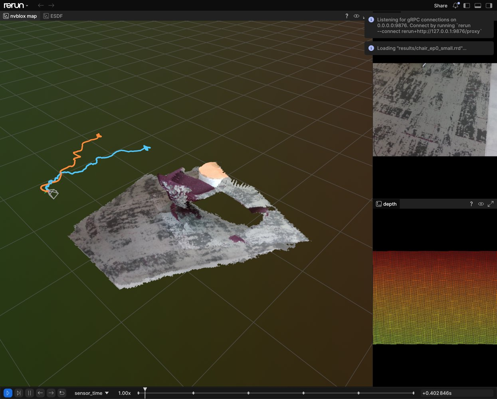

The coloured mesh (armchair in purple, stool, carpet), the ICP trajectory in
blue and the legged odometry in orange, with the colour and depth stream on the
right; the ESDF (941 k voxels) has its own tab so it does not bury the mesh.
The 85 MB full recording is slow to load, so that still was taken from a
lighter one (`--frame-stride 100 --no-esdf`) with
`rerun --window-size 1600x1000 --screenshot-to out.png file.rrd`.

The same script writes the stills in this README: `--png` renders offscreen
through Open3D's EGL backend (needs the GPU flags, including `graphics`, but no
display), `--plot` is plain matplotlib:

```bash
podman run --rm \
  --runtime=/usr/bin/nvidia-container-runtime \
  -e NVIDIA_VISIBLE_DEVICES=all -e NVIDIA_DRIVER_CAPABILITIES=compute,utility,graphics \
  -v "$PWD/results":/results slam_zero_to_hero:nvblox \
  python3 /nvblox_demo/scripts/viz_nvblox.py /results/chair_ep0 --png /results/chair_ep0_mesh.png
podman run --rm -v "$PWD/results":/results slam_zero_to_hero:nvblox \
  python3 /nvblox_demo/scripts/viz_nvblox.py /results/chair_ep0 --plot /results/chair_ep0_traj.png
```

## Online SLAM: cuVSLAM + nvblox

The pipeline above computes all the poses first and fuses afterwards. This one is
the Isaac-style system the final project is about: [cuVSLAM](../cuvslam) tracks
the head camera and nvblox fuses each frame **as it arrives**, in one Python
process ([`scripts/cuvslam_nvblox.py`](scripts/cuvslam_nvblox.py), on
[nvblox_torch](https://github.com/nvidia-isaac/nvblox/tree/main/nvblox_torch)).
[`scripts/run_all.sh`](scripts/run_all.sh) runs it over the demo's 8 episodes,
one after another — each with its own tracker, map and rerun recording, since
separate recordings share no coordinate frame:

| Task | Episodes |
|---|---|
| `walk_towards_chair_and_rotate_the_chair` | 0, 1, 2 |
| `walk_towards_outside_chair_and_pull_it_out` | 0, 1, 2 |
| `walk_towards_trashbin_and_throw_trash_inside` | 0, 1 |

These are the three tasks [`../download_humanoid_everyday.py`](../download_humanoid_everyday.py)
downloads by default. None of them covers much ground, so the same script also runs
a TUM RGB-D office loop: see [A bigger scene](#a-bigger-scene-tum-rgb-d-fr3long_office_household).

Per frame:

1. **cuVSLAM, RGB-D mode**, tracks the colour camera. It needs depth registered
   to that image, so the raw depth is warped into the colour camera and the holes
   the warp leaves are filled.
2. **nvblox** integrates the *raw* depth in the depth camera's own frame, and the
   colour image in the colour camera's, at the pose cuVSLAM just returned.
3. The pose, the image with cuVSLAM's tracked features, the trajectory against the
   legged odometry and, every 15 frames, the colour mesh and the
   [occupancy map](#occupancy-map) are streamed to rerun. The
   mesh goes in 1 m cubes and only the cubes that changed are re-sent, so the map
   grows on the timeline together with the trajectory: scrub back and it shows the
   map as it was at that frame. Sending the whole mesh each time made 1.6 GB for the
   8 episodes, more than a browser tab keeps; this way it is ~570 MB, before the
   occupancy map, which goes the same way and adds about a tenth. The cubes are
   cut on the GPU, where nvblox keeps the mesh, so a large map does not slow the
   frame rate down.

The world frame is gravity-aligned with the floor at z = 0, anchored on the
first frame by the robot IMU as in the ICP pipeline.

### Run the two demos with a GUI

The same image and script run two demos; only the data changes:

| Demo | What it shows | Data |
|---|---|---|
| **A. Humanoid Everyday** | a Unitree G1's head camera, 8 short episodes one after another | `~/data/humanoid_everyday`, [download](#download-the-dataset) |
| **B. TUM RGB-D office loop** | a hand-held Kinect walked 22 m round an office, one sequence | `~/data/tum_rgbd`, [download](#a-bigger-scene-tum-rgb-d-fr3long_office_household) |

The GUI is the [Rerun](https://rerun.io) viewer. It can run in a browser or as a
native window on the host.

**Option 1: in a browser.** With `--serve` the container hosts the rerun web viewer
itself, so the host needs nothing installed:

```bash
# Demo A: Humanoid Everyday
podman run --rm -p 9090:9090 -p 9877:9877 \
  --runtime=/usr/bin/nvidia-container-runtime \
  -e NVIDIA_VISIBLE_DEVICES=all -e NVIDIA_DRIVER_CAPABILITIES=compute,utility \
  -v ~/data/humanoid_everyday:/data:ro \
  -v "$PWD/results":/results \
  slam_zero_to_hero:nvblox \
  /nvblox_demo/scripts/run_all.sh /data /results/cuvslam --serve

# Demo B: TUM RGB-D fr3/long_office_household
podman run --rm -p 9090:9090 -p 9877:9877 \
  --runtime=/usr/bin/nvidia-container-runtime \
  -e NVIDIA_VISIBLE_DEVICES=all -e NVIDIA_DRIVER_CAPABILITIES=compute,utility \
  -v ~/data/tum_rgbd:/tum:ro \
  -v "$PWD/results":/results \
  slam_zero_to_hero:nvblox \
  /nvblox_demo/scripts/run_all.sh /tum/rgbd_dataset_freiburg3_long_office_household /results/tum --serve
```

The first thing either one prints is the URL to open,
**`http://localhost:9090/?url=rerun+http://localhost:9877/proxy`**. The server
buffers the stream, so a browser opened late still gets everything sent so far.
After the last episode the viewer keeps serving until Ctrl-C. To watch from another
machine, forward both ports (`ssh -L 9090:localhost:9090 -L 9877:localhost:9877 <host>`):
the page fetches the data from 9877 itself.

**Option 2: a native viewer on the host.** Start `rerun` on the host first; its
`rerun --version` must match the image's 0.33.0 (`pip install rerun-sdk==0.33.0`
installs it). The container then streams to it over `--network=host`:

```bash
rerun &   # on the host, once; it listens on rerun+http://127.0.0.1:9876/proxy

# Demo A: Humanoid Everyday
podman run --rm --network=host \
  --runtime=/usr/bin/nvidia-container-runtime \
  -e NVIDIA_VISIBLE_DEVICES=all -e NVIDIA_DRIVER_CAPABILITIES=compute,utility \
  -v ~/data/humanoid_everyday:/data:ro \
  -v "$PWD/results":/results \
  slam_zero_to_hero:nvblox \
  /nvblox_demo/scripts/run_all.sh /data /results/cuvslam

# Demo B: TUM RGB-D fr3/long_office_household
podman run --rm --network=host \
  --runtime=/usr/bin/nvidia-container-runtime \
  -e NVIDIA_VISIBLE_DEVICES=all -e NVIDIA_DRIVER_CAPABILITIES=compute,utility \
  -v ~/data/tum_rgbd:/tum:ro \
  -v "$PWD/results":/results \
  slam_zero_to_hero:nvblox \
  /nvblox_demo/scripts/run_all.sh /tum/rgbd_dataset_freiburg3_long_office_household /results/tum
```

What the viewer shows, in either option:

- **Left, top:** the colour image with the features cuVSLAM is tracking.
- **Left, bottom:** the tracked-feature count and the gravity error over time.
- **Right, two tabs:** **occupancy voxels**, the one that opens, with every occupied
  voxel as a cube coloured by height (see [Occupancy map](#occupancy-map)), and
  **nvblox mesh**, the colour mesh. Both show the camera, cuVSLAM's trajectory
  (orange) and the reference trajectory (blue): the legged odometry in demo A, the
  mocap ground truth in demo B.
- **Bottom:** the frame timeline. Scrub it back and the map shrinks to what had
  been mapped by that frame.

Each episode is its own recording in the **Sources** list on the left; click one to
switch to it.

Each episode prints `[stream] <episode> -> <url>` once it is connected.
The layout shows up right away, but on the first episode the first frame arrives
about 25 s later: cuVSLAM and nvblox are still starting up CUDA, so keep the viewer
open. With no viewer listening, the demo says so and runs without streaming. If a
viewer is closed mid-sweep, only the stream stops, and the next episode reconnects
if a viewer is back. Ctrl-C stops the sweep and still writes the summary of the
episodes that finished.

Options, after the output directory: `--serve` (with `--web-port` / `--grpc-port`,
default 9090 / 9877), `--no-stream`, `--no-stream-images`, `--no-occupancy`, `--stream-url URL`,
`--save-rrd` (one `.rrd` per episode under `rrd/` instead of streaming; ~64 MB for
`chair/episode_0`, 5 MB of it the occupancy map), `--mesh-every N`, `--slam` (cuVSLAM's loop-closing SLAM layer;
these episodes have almost no revisits, so it changes little), `--voxel`,
`--frames`. To run a subset: `-e TASKS="walk_towards_chair_and_rotate_the_chair"`,
`-e EPISODES="episode_0"`.

Per episode, `results/cuvslam/<task>/<episode>/` gets `traj_cuvslam.tum`,
`traj_odom.tum` (legged odometry in the same world frame), `mesh.ply` and
`stats.json` (with the final map's occupied-voxel count); `results/cuvslam/summary.md`
has the table of all of them.

On the first run on an RTX 50-series GPU nvblox_torch JIT-compiles its kernels
(the release wheel ships sm_90 PTX, no sm_120 code), which takes about a minute.
After that it runs at 30–35 fps on an RTX 5090 with meshing and the stream written
out (`--save-rrd`) — faster than the 30 Hz recording.

`walk_towards_chair_and_rotate_the_chair/episode_0` — carpet, armchair and stool
sharp, like the ICP map. Grey is surface the depth camera saw but the narrower
colour camera did not:

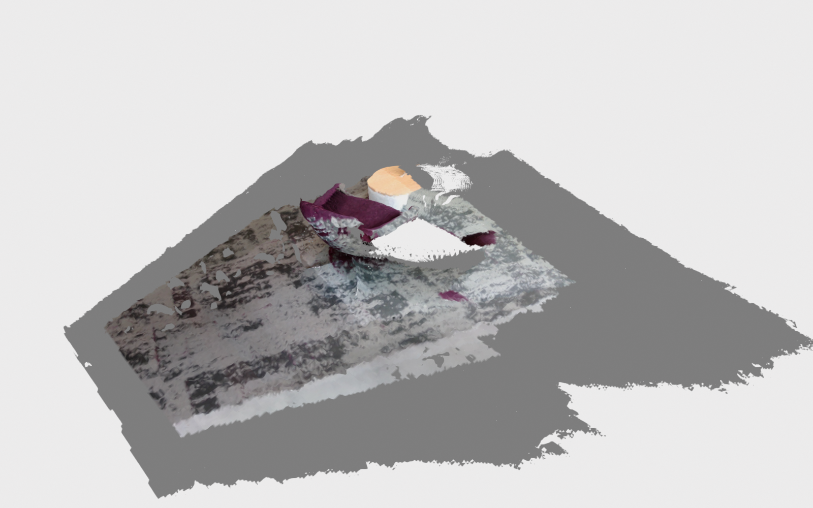

### A bigger scene: TUM RGB-D fr3/long_office_household

Humanoid Everyday is a manipulation dataset. Of 64 episodes measured, none walks
more than 3 m of path, and the tasks that turn around and walk off
(`place_kettle_near_coffee_maker`, `clean_the_window`,
`pick_up_a_duster_turn_around_...`, 9 episodes tried) all drift in cuVSLAM, with
gravity errors of 20–149°. For a scene the camera actually travels through,
`scripts/cuvslam_nvblox.py` also takes a [TUM RGB-D](https://cvg.cit.tum.de/data/datasets/rgbd-dataset)
sequence. `fr3/long_office_household` is a hand-held Kinect carried for 87 s in a
22 m loop round two desks set back to back, with motion-capture ground truth. It
ends where it started, so `--slam` has a loop to close.

Download it (1.5 GB; [`../download_tum_3d.py`](../download_tum_3d.py) fetches it
together with 14 other TUM sequences):

```bash
mkdir -p ~/data/tum_rgbd && cd ~/data/tum_rgbd
wget https://cvg.cit.tum.de/rgbd/dataset/freiburg3/rgbd_dataset_freiburg3_long_office_household.tgz
tar xzf rgbd_dataset_freiburg3_long_office_household.tgz && rm rgbd_dataset_freiburg3_long_office_household.tgz
```

Then run demo B from [Run the two demos with a GUI](#run-the-two-demos-with-a-gui):
`run_all.sh` takes the sequence directory where it otherwise takes the data root.
The results land in `results/tum/rgbd_dataset_freiburg3_long_office_household/`.

What changes against Humanoid Everyday:

- The Kinect's depth is stored already registered to the colour image, in units of
  1/5000 m, so cuVSLAM and nvblox take it as it is: no warp, one camera model
  (TUM's fr3 calibration). The fr3 images are stored undistorted, which is why only
  fr3 sequences are accepted.
- Colour and depth have separate timestamps. Each colour image is paired with the
  nearest depth image and ground-truth sample, at most 20 ms away, as TUM's
  `associate.py` does. 2486 of the 2585 colour frames get a pair.
- fr3 has no accelerometer data, so the first frame starts at its mocap pose. The
  mocap frame is z-up with the floor at z = 0 (the floor's depth points land within
  2 cm of it), so the world frame matches Humanoid Everyday's. Every pose after the
  first comes from cuVSLAM.
- The reference is the mocap ground truth instead of the legged odometry. It is
  written to `traj_groundtruth.tum`, drawn as the blue line in the viewer, and the
  gravity error is measured against its orientation.

On an RTX 5090:

| | odometry (default) | `--slam` |
|---|---|---|
| frames tracked | 2486 / 2486 | 2486 / 2486 |
| ATE vs mocap, RMSE / max | 6.6 / 13.4 cm | 5.6 / 14.5 cm |
| end-to-start distance (mocap: 0.755 m) | 0.617 m | 0.754 m |
| gravity error, median / max | 1.72° / 3.27° | 1.65° / 3.55° |
| path length (mocap: 22.14 m) | 24.28 m | 24.55 m |

Path length counts per-frame jitter, so it reads about 10 % long in both columns; go
by the ATE instead. With `--slam` the loop closure pulls the end of the trajectory
back onto its start. The map does not follow it, though: nvblox already fused the
earlier frames at the poses cuVSLAM gave at the time.

The final map is 1.74 M triangles. The run keeps up with the 30 Hz recording while
it streams: 38.6 fps when the stream goes to a file, and 32.9 fps when it is served
to a browser on the same machine. With `--no-stream`, which also skips meshing until
the end, it runs at 86 fps (measured with `--slam`). The recording is ~670 MB, small
enough for a browser tab to hold all of it: a tab opened after the run still scrubs
back to frame 0 and shows the map as it was then.

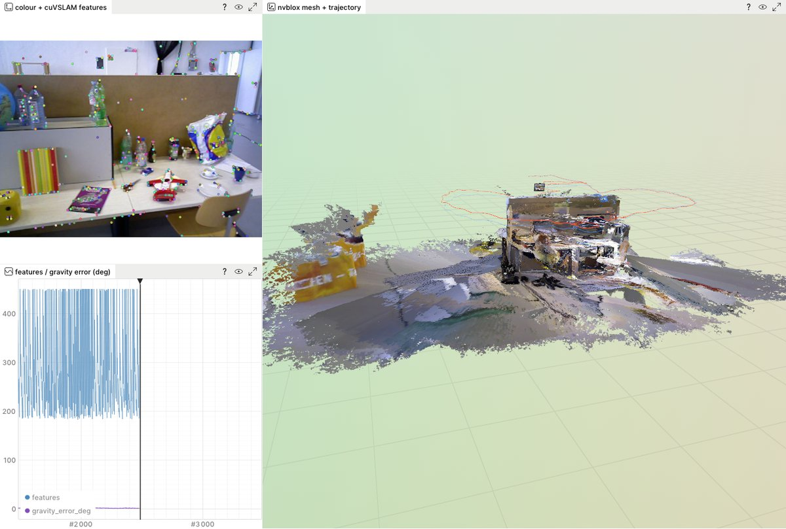

This is the end of the loop, in a browser tab opened after the run. The two desks
are in the middle; the orange line is cuVSLAM's trajectory around them and the blue
line is the mocap's.

### Occupancy map

The first tab on the right shows the map as a 3D occupancy grid. Every occupied
voxel is a solid cube at the TSDF's own resolution: 1.5 cm by default, and
`--voxel` changes both maps. The cubes are coloured by height, from dark blue at
the floor through green at seat height to red from 1.2 m up.

The occupancy is read on the GPU from the TSDF nvblox is already building, every
time the mesh is (`--mesh-every`), so no depth image is integrated twice. That
makes it a different thing from nvblox' probabilistic occupancy integrator
(`ProjectiveIntegratorType.OCCUPANCY`, log-odds as in OctoMap), which would need a
second map. A voxel counts as **occupied** when it has been observed inside a
surface (signed distance ≤ 0) and one of its six neighbours has been observed as
free space (distance > 0). That is the one-voxel shell where the sign changes.
Free space and unobserved voxels are not drawn.

A simpler rule does not work. "Occupied if the distance is between −1 voxel and
0" leaves the floor full of holes. nvblox' projective TSDF measures distance along
the camera ray, and on a surface seen at a slant that is 1/cos(incidence) times the
true distance, twice at 60°. The G1's head camera looks 56° down at the floor, so
the sign change regularly jumps across a one-voxel band.

The cubes are streamed in 1 m chunks, and only the chunks that changed are re-sent,
the same way as the mesh. Measured back to back on an RTX 5090, with the stream
written to a file (`--save-rrd`):

| Sequence | Occupied voxels (final map) | fps, without / with | `.rrd`, without / with |
|---|---|---|---|
| `walk_towards_chair_and_rotate_the_chair/episode_0` | 98 k | 27.4 / 26.7 | 59 / 64 MB |
| TUM `fr3/long_office_household` | 573 k | 35.4 / 34.2 | 425 / 470 MB |

`--no-occupancy` turns it off.

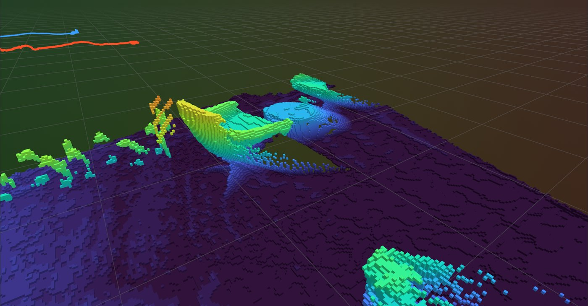

`walk_towards_chair_and_rotate_the_chair/episode_0` at 1.5 cm: the armchair
(yellow-green) and the round stool (cyan) on the carpet.

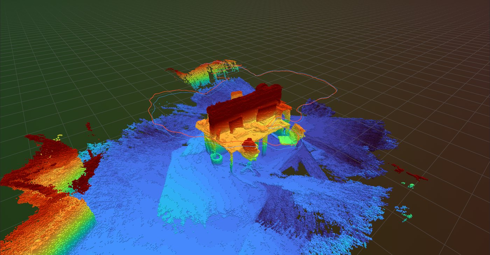

The TUM office: the two desks back to back, their tops orange at ~0.75 m and the
monitors red, with cuVSLAM's loop (orange) and the mocap's (blue) overhead.

## Poses: where the trajectory comes from

The recording carries the G1's own legged odometry, so the obvious thing is to
compose it with the pelvis-to-camera extrinsic and hand that to nvblox. It does
not work well. Left, `POSES=icp`; right, `POSES=odom`, same episode, same
everything else:

| depth ICP | legged odometry |
|---|---|
| 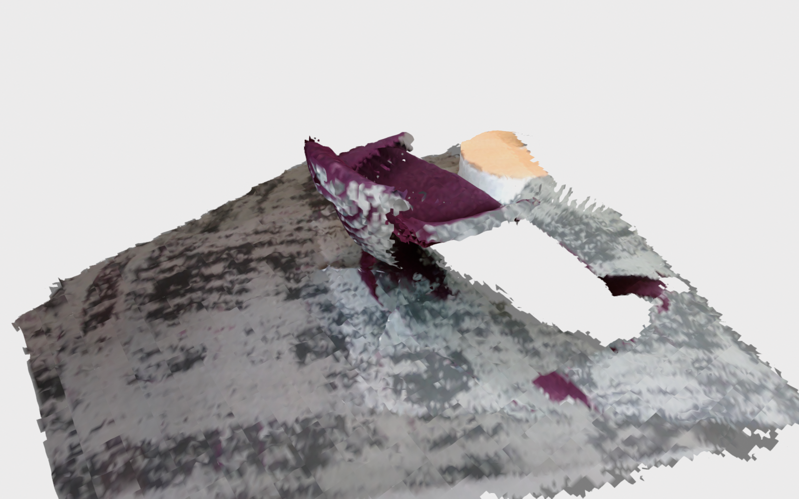 | 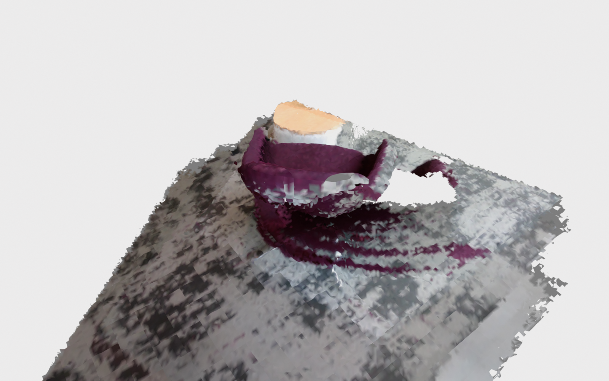 |

The odometry gets the *net* displacement about right — 1.21 m against ICP's
1.30 m over this episode — but it smears the TSDF: the armchair drags into
concentric arcs across the carpet. Its path length is also 30 % short (2.06 m
against 2.97 m), because it does not see the head oscillating at every footfall,
which is exactly the motion a 30 Hz camera integrates over.

So the default pose source is **depth frame-to-model ICP** (Open3D,
point-to-plane) inside the converter. Frame-to-model rather than
frame-to-frame — consecutive-frame ICP compounds its error at every step and
pulls the map apart over 581 frames. The first pose is anchored with the IMU:
roll and pitch are gravity-referenced, so the world comes out z-up with the
floor at z = 0, which also gives nvblox' ground-plane RANSAC (which only looks
between z = −0.1 and z = 0.15 m) something to find.

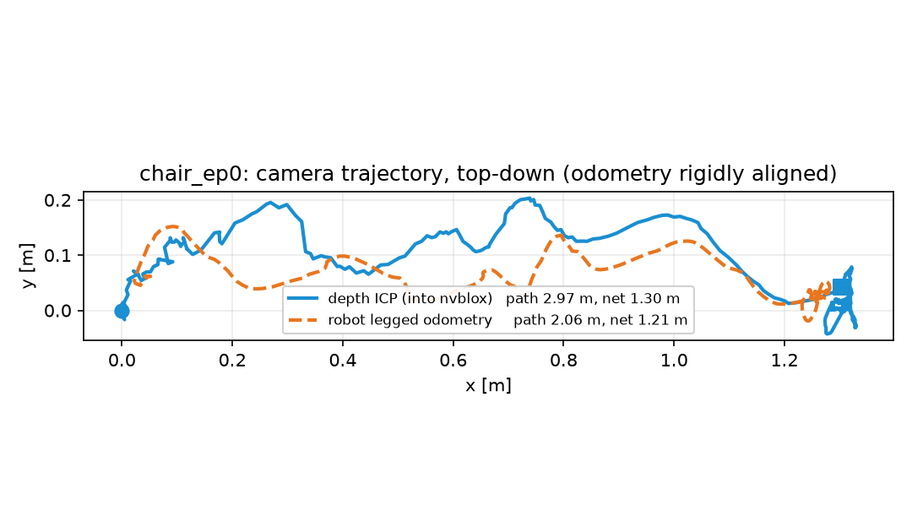

`config/humanoid_everyday_d435.json` holds the intrinsics and the depth-to-colour
extrinsic verbatim from the dataset README, plus a pelvis-to-camera extrinsic
that is **not** in the dataset and was measured here: the rotation by hand-eye
between the ICP trajectory and the odometry orientation (1.4° median residual
over 10-frame steps), the height from a RANSAC floor plane. It comes out as a
forward-looking camera pitched **56.1° down** — which is why so much of every
frame is floor and tabletop, and why sequence choice matters so much below.

## Output

Fusion runs at **136 Hz** end to end on an RTX 5090 — depth integration, colour
integration, meshing and ESDF for every one of the 581 frames, at 1.5 cm voxels.
Means per frame from `timings.txt`:

| Stage | Mean per frame |
|---|---|
| `fuser/integrate_depth` | 0.21 ms |
| `fuser/integrate_color` | 0.98 ms |
| `fuser/mesh` | 0.77 ms |
| `fuser/integrate_esdf` | 2.26 ms |
| **`fuser/time_per_frame`** (all mapping) | **4.22 ms — 237 Hz** |
| `fuser/file_loading` (JPEG + PNG off disk) | 2.94 ms |

The ESDF dominates and the mapping itself is 4.2 ms; the 136 Hz figure is what
you get once reading the frames off disk is counted, which a live sensor would
not pay.

A re-run on 2026-09-28, with the GPU and disk shared with other jobs, gave the
same trajectory (2.97 m ICP, 2.06 m odometry, identical to the centimetre) and
4.17 ms per frame once the first frame is dropped: that one frame costs 0.8 s of
CUDA warm-up and pulls the plain mean up to 5.6 ms. Converting the episode took
about 2 min (21 s of it ICP). Writing `map.nvblx` took 203 s that time against
0.4 s the first: that is nvblox' SQLite serialiser waiting on a busy disk, not
the mapping.

Three independent checks that the map is actually right, not just pretty:

- **The floor lands where gravity says it should.** nvblox' own ground-plane
  RANSAC puts it 2 mm from z = 0 with its normal 2.1° off vertical, after 581
  frames tracked from an IMU-anchored first pose. That 2.1° is the accumulated
  roll/pitch drift of the whole run. (One run — the RANSAC is stochastic, so
  expect a few mm and about 2°.)
- **Heights are metric.** On the `walk_towards_outside_chair_and_pull_it_out`
  episode, the reconstructed café tabletop sits **0.735 m** above the
  reconstructed brick paving — standard table height, from nothing but stereo
  depth and ICP.
- **ICP stays locked.** Median point-to-plane fitness 1.000 with 0.6–0.9 cm
  inlier RMSE across every frame.

`FRAME=depth` keeps the depth camera's 79° field of view instead of cropping to
the colour camera's 56°, which **triples the mapped floor area** — 20.9 m²
against 6.8 m², counting the middle 98 % of vertices so the odd stereo streak
does not flatter it — at the cost of colour in the periphery, which the colour
camera never saw. Shaded rather than coloured, for that reason:

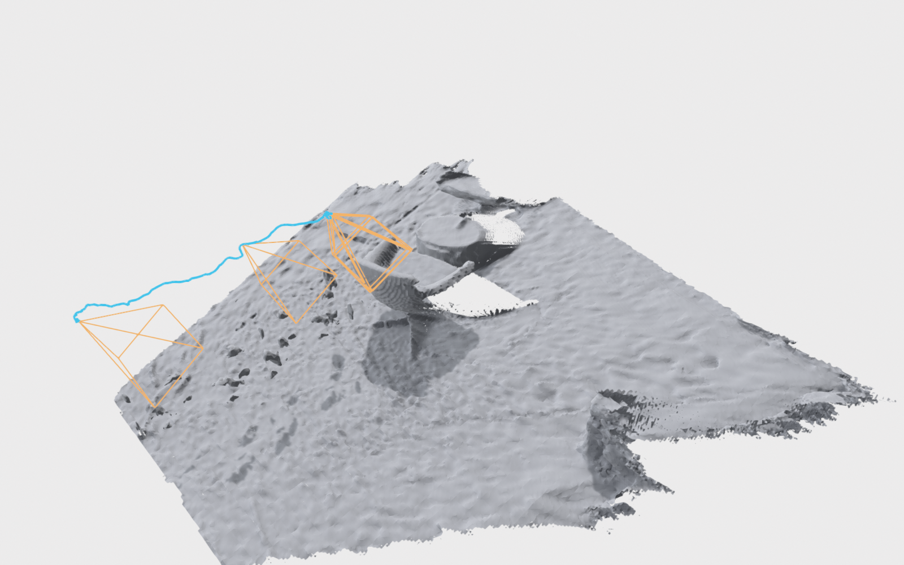

## Choosing a sequence: most of this dataset cannot be tracked

The head camera is pitched 56° down, so the average frame is a single plane of
floor. That is *degenerate* for depth ICP: on one plane the camera can slide
freely within it and spin about its normal at no cost, and the tracker drifts
without the residual ever complaining.

The symptom is unmissable once it happens. `pick_up_a_caution_sign_stand_and_walk_to_put_it_agaist_wall`
covers the most ground of any task here, and its map collapses into a cone as the
floor gets swept around the camera:

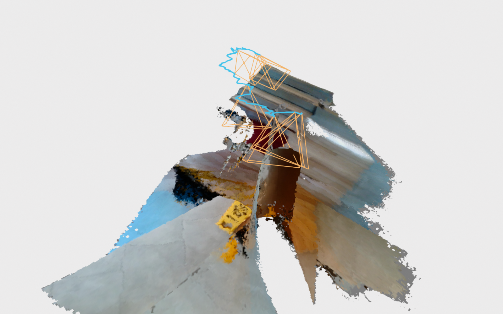

That is predictable before running anything, from the conditioning of the
point-to-plane ICP normal equations — the ratio of largest to smallest eigenvalue
of the 6×6 Hessian, over a sample of frames. Measured across every episode
downloaded:

| Task | ICP cond. | Non-planar | Verdict |
|---|---|---|---|
| `walk_towards_outside_chair_and_pull_it_out` | 11–13 | 0.35–0.39 | tracks; smallest map (2.3 × 2.3 m) |
| `walk_towards_trashbin_and_throw_trash_inside` | 12–15 | 0.47–0.55 | tracks; very short, close range |
| `walk_towards_fire_extinguisher_and_open_door` | 15–17 | 0.39–0.41 | tracks; white walls, glass |
| **`walk_towards_chair_and_rotate_the_chair`** | **36–45** | 0.18–0.21 | **tracks; the one used here** |
| `pick_up_a_caution_sign_stand_and_walk_to_put_it_agaist_wall` | 34–41 | 0.14–0.33 | **fails**, 6.6° gravity drift |
| `walk_towards_elevator_and_push_button` | 66–138 | 0.15–0.22 | worst conditioned; corridor wall is one plane |

Conditioning alone is not the whole story — `walk_towards_chair_and_rotate_the_chair`
scores mid-table but reconstructs cleanly, because its patterned carpet, armchair
and stool break the plane where it counts, while it also walks further than the
better-conditioned tasks. The end-to-end drift number is what settles it, and the
cheapest one to read is the tilt of nvblox' own fitted ground plane, since the
world frame started out gravity-aligned:

| Episode | ICP path | Ground-plane tilt | Map extent |
|---|---|---|---|
| `walk_towards_chair_and_rotate_the_chair/episode_0` | 2.97 m | 2.2° | 3.0 × 2.9 m |
| `walk_towards_chair_and_rotate_the_chair/episode_2` | 3.79 m | 1.7° | 3.0 × 3.3 m |
| `walk_towards_outside_chair_and_pull_it_out/episode_0` | 2.67 m | 1.0° | 2.3 × 2.3 m |
| `pick_up_a_caution_sign_stand_and_walk_to_put_it_agaist_wall/episode_1` | 7.07 m | **6.6°** | 5.0 × 4.3 m, collapsed |

One honest limitation: Humanoid Everyday is a *manipulation* dataset with
locomotion attached, so even the walking tasks only travel about 1.2 m net per
episode. These are room-corner maps, not building tours. For a map the camera
walks through, see the [TUM office loop](#a-bigger-scene-tum-rgb-d-fr3long_office_household).

## Supported datasets

| Dataset | Command | Status |
|---|---|---|
| **Humanoid Everyday** `walk_towards_chair_and_rotate_the_chair/episode_0` (default) | `run_nvblox.sh /data/walk_towards_chair_and_rotate_the_chair/episode_0 /results/chair_ep0` | ✅ re-verified 2026-09-28: 581 frames, ICP path 2.97 m (net 1.30 m), ground plane 1.9 mm from z=0 and 2.1° off vertical, 4.2 ms/frame mapping |
| Humanoid Everyday `walk_towards_chair_and_rotate_the_chair/episode_2` | same, `.../episode_2` | ✅ ICP path 3.79 m, 1.7° ground-plane tilt |
| Humanoid Everyday `walk_towards_outside_chair_and_pull_it_out/episode_0` | same, `.../walk_towards_outside_chair_and_pull_it_out/episode_0` | ✅ ICP path 2.67 m, 1.0° tilt; café tabletop 0.735 m above the paving |
| Humanoid Everyday `pick_up_a_caution_sign...`, `walk_towards_elevator...` | same | ❌ planar scenes, ICP drifts and the map collapses (see above) |
| Humanoid Everyday, chair / outside_chair / trashbin (8 episodes), cuVSLAM + nvblox online | `run_all.sh /data /results/cuvslam` | ✅ verified 2026-10-21; re-run 2026-10-26 with identical trajectories at 30–35 fps, browser viewer (`--serve`) verified; occupancy map verified 2026-10-27 on `chair/episode_0` (98 k voxels at 1.5 cm) — see [Online SLAM](#online-slam-cuvslam--nvblox) |
| TUM RGB-D `fr3/long_office_household`, cuVSLAM + nvblox online | `run_all.sh /tum/rgbd_dataset_freiburg3_long_office_household /results/tum` | ✅ verified 2026-10-26: 2486 frames, ATE 6.6 cm vs mocap (5.6 cm with `--slam`), 33–39 fps while streaming; occupancy map verified 2026-10-27 (573 k voxels at 1.5 cm, same trajectory) — see [A bigger scene](#a-bigger-scene-tum-rgb-d-fr3long_office_household) |
| Replica, Redwood, 3DMatch, cuSFM, PLY LiDAR | the fusers below, on their native layouts | Builds; not run in this demo |

`fuse_replica` is one of five fusers the image builds; all of them are on the
`PATH`.

| Fuser | Layout | Notes |
|---|---|---|
| **`fuse_replica`** | `cam_params.json`, `seq/traj.txt`, `seq/results/{frame,depth}NNNNNN.{jpg,png}` | What this demo converts into. `../download_replica.py` gets the original Replica sequences. |
| `fuse_3dmatch` | `camera-intrinsics.txt`, `seq-NN/frame-NNNNNN.{pose.txt,depth.png,color.png}` | Applies a Y-up→Z-up rotation to every pose, unlike the others. |
| `fuse_redwood` | Redwood Indoor LiDAR-RGBD | `../download_redwood.py`. |
| `fuse_cusfm` | cuSFM output | |
| `fuse_lidarply` | PLY scans + poses | The one to use for the LiDAR clouds this demo ignores. |

To point the converter at another Humanoid Everyday task, pass the episode
directory; `--robot h1` switches to the H1 intrinsics (its pelvis-to-camera
extrinsic is *not* measured, so `POSES=odom` on H1 is indicative only).
