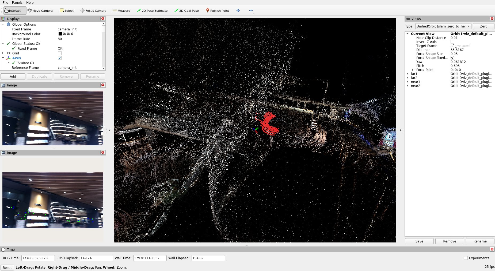
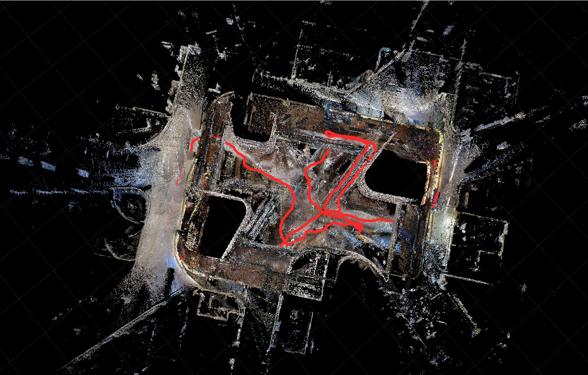
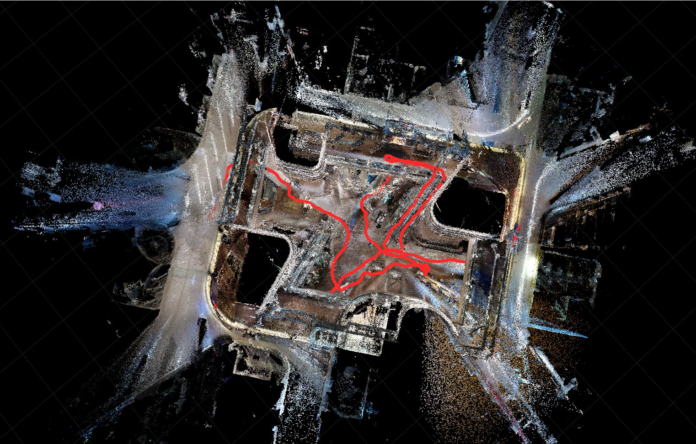
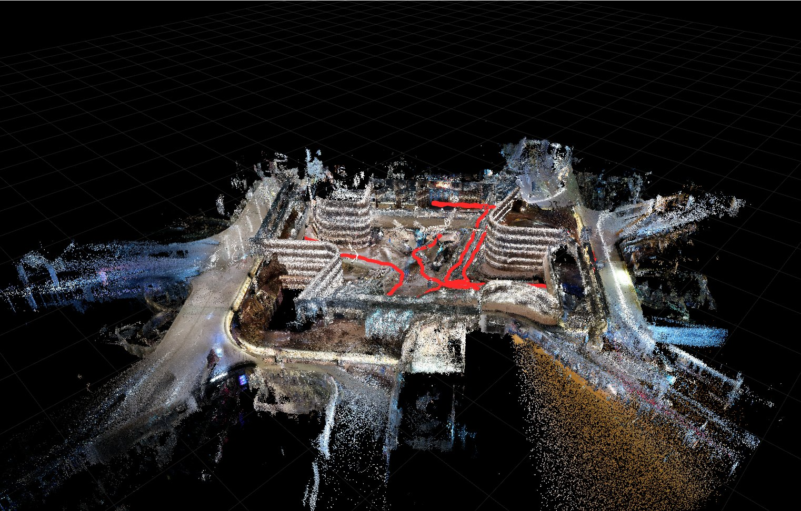
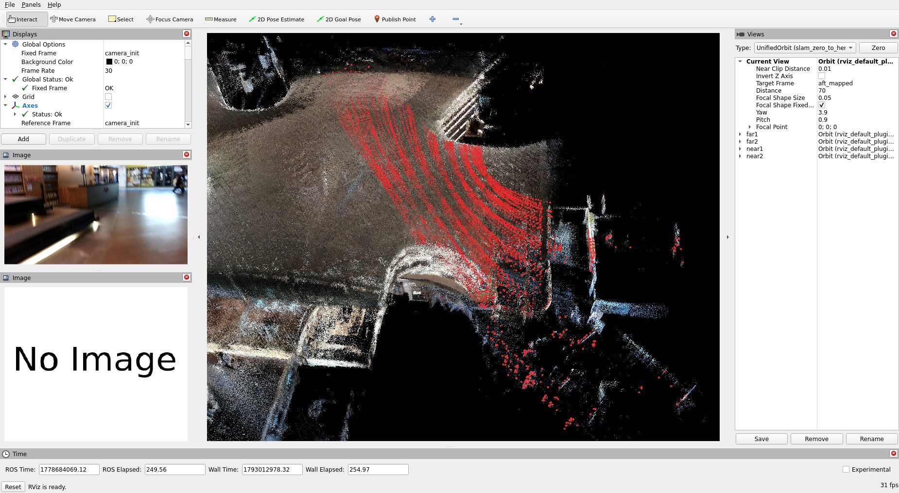
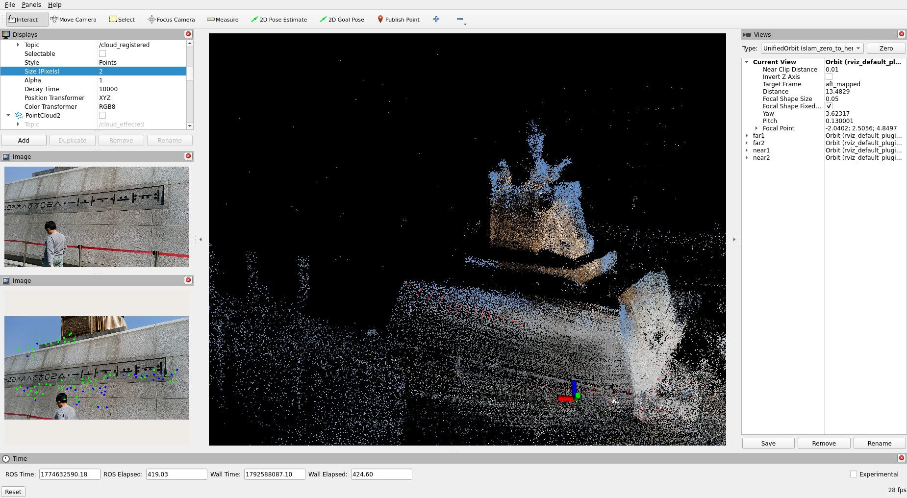
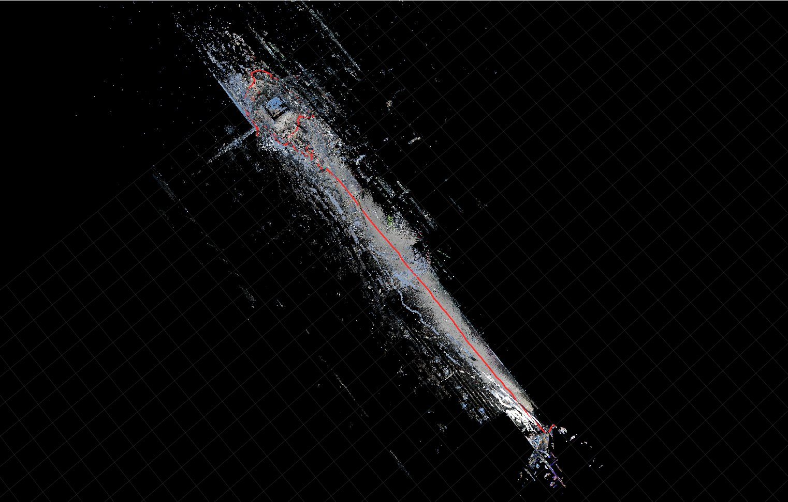

# UAMC — handheld LiDAR-inertial-visual scanner

A complete handheld 3D scanner, hardware and software, from [U-AMC](https://github.com/U-AMC):
a 3D-printable rig that carries a Livox LiDAR, an Oak-D Pro camera and a Jetson Orin,
plus a ROS 2 Humble port of FAST-LIVO2 that runs the mapping on that Orin. Between them
they cover the part of SLAM the papers leave out — what the sensor rig physically is, how
its clocks are synchronised, and what has to change in an algorithm to make it run on
embedded hardware rather than a workstation.

The demo runs U-AMC's FAST-LIVO2-ROS2 on a bag recorded with the rig itself: the COEX
sequence **`lvi_coex_set_2`** (COEX mall, Seoul, 334.7 s, Livox Mid-360 and Avia, their IMUs,
Oak-D RGB), from `~/data/gwanghwamun_coex`, LiDAR-visual-inertial and LiDAR-inertial, plus a
camera-coloured map from both LiDARs; and the same two runs on the 14-minute Gwanghwamun walk.
There is no ground truth for either.

The source of both repositories is vendored here verbatim, so everything the students
build is in the folder they clone. Neither is a git submodule.

| Directory | Upstream | Vendored at | License |
|---|---|---|---|
| [`UAMHD-Mapping/`](UAMHD-Mapping/) | [U-AMC/UAMHD-Mapping](https://github.com/U-AMC/UAMHD-Mapping) | `361dabd` (2026-05-31) | CC BY-NC-SA 4.0 |
| [`FAST-LIVO2-ROS2/`](FAST-LIVO2-ROS2/) | [U-AMC/FAST-LIVO2-ROS2](https://github.com/U-AMC/FAST-LIVO2-ROS2) | `a09599a` (2026-05-16) | GPLv2 |
| [`rpg_vikit_rational_polynomial/`](rpg_vikit_rational_polynomial/) | [U-AMC/rpg_vikit_rational_polynomial](https://github.com/U-AMC/rpg_vikit_rational_polynomial) | `6f213c7` (2026-03-21) | GPLv3 per `package.xml`; no `LICENSE` file — see below |

Copied 2026-08-06 with `git archive HEAD`, so each tree is exactly its upstream tracked
files at that commit — no `.git`, nothing added, nothing removed. To refresh one, re-run
the archive from a fresh clone and record the new SHA in the table above. The one fix the
demo needs in vikit is kept as a separate patch under [`patches/`](patches/) and applied at
image build time.

## Build

```bash
podman build -t slam_zero_to_hero:uamc .
```

Run from this folder: the build context is `uamc/`, so the image compiles the vendored
`FAST-LIVO2-ROS2/` and `rpg_vikit_rational_polynomial/` trees (no clone of either) on
`ros:humble-perception-jammy`, plus Livox-SDK2 and `livox_ros_driver2` pinned by commit.
The image is CPU only; RViz uses the host GPU when the run passes it in ([Run](#run)), else Mesa. It applies
[`patches/vikit_remote_camera_params.patch`](patches/vikit_remote_camera_params.patch)
to vikit — without it `fastlivo_mapping` dies with SIGFPE before the first scan (see
[NOTES.md](NOTES.md#upstream-bugs-worked-around-in-the-image)). A final check fails the
build if `fastlivo_mapping` is missing. `FAST-LIVO2-ROS2/Dockerfile` is upstream's own and
is not used.

## Run

### 1. Get the bag (once)

```bash
python3 ../download_gwanghwamun_coex.py --extract --patch-type   # lvi_coex_set_2: 10.4 GB, 21.6 GB unpacked
```

`--patch-type` is required — see [The dataset](#the-dataset).

### 2. Run with RViz on your desktop

Run every command from this folder (`SLAM_zero_to_hero/uamc`). All of them use the Mid-360
LiDAR and its IMU; LiDAR-visual-inertial adds the Oak-D camera. RViz opens on your display
and follows the scanner. The bag plays in real time (Gwanghwamun 14 min, COEX 5.5 min);
then the trajectory, the map and `stats.txt` are written to `results/<name>/`, and **RViz
stays open with the final map until you close its window**, which ends the container.
Closing RViz before the bag ends stops the run early and still writes everything up to
that point.

Gwanghwamun has no public download link (see [The dataset](#the-dataset)). Once its archive
is in `~/data/gwanghwamun_coex/`, unpack and type-patch it first:
`python3 ../download_gwanghwamun_coex.py lvi_ghm_set --extract --patch-type`.

**1. Gwanghwamun, LiDAR-visual-inertial** ([`config/ghm_mid360_lvi.yaml`](config/ghm_mid360_lvi.yaml)):

```bash
mkdir -p results/ghm_mid360_lvi
podman run --rm \
  --runtime=/usr/bin/nvidia-container-runtime \
  -e NVIDIA_VISIBLE_DEVICES=all -e NVIDIA_DRIVER_CAPABILITIES=graphics,compute,utility \
  -e DISPLAY=$DISPLAY -v /tmp/.X11-unix:/tmp/.X11-unix \
  -v ~/data/gwanghwamun_coex:/data:ro -v "$PWD":/uamc:ro -v "$PWD/results/ghm_mid360_lvi":/out \
  -e RVIZ=true -e BAG=/data/extracted/lvi_ghm_set -e CONFIG=/uamc/config/ghm_mid360_lvi.yaml \
  slam_zero_to_hero:uamc bash /uamc/scripts/run_coex.sh
```

**2. Gwanghwamun, LiDAR-inertial** ([`config/ghm_mid360_lio.yaml`](config/ghm_mid360_lio.yaml)):

```bash
mkdir -p results/ghm_mid360_lio
podman run --rm \
  --runtime=/usr/bin/nvidia-container-runtime \
  -e NVIDIA_VISIBLE_DEVICES=all -e NVIDIA_DRIVER_CAPABILITIES=graphics,compute,utility \
  -e DISPLAY=$DISPLAY -v /tmp/.X11-unix:/tmp/.X11-unix \
  -v ~/data/gwanghwamun_coex:/data:ro -v "$PWD":/uamc:ro -v "$PWD/results/ghm_mid360_lio":/out \
  -e RVIZ=true -e BAG=/data/extracted/lvi_ghm_set -e CONFIG=/uamc/config/ghm_mid360_lio.yaml \
  slam_zero_to_hero:uamc bash /uamc/scripts/run_coex.sh
```

**3. COEX, LiDAR-inertial** ([`config/coex_mid360_lio.yaml`](config/coex_mid360_lio.yaml)):

```bash
mkdir -p results/coex_mid360_lio
podman run --rm \
  --runtime=/usr/bin/nvidia-container-runtime \
  -e NVIDIA_VISIBLE_DEVICES=all -e NVIDIA_DRIVER_CAPABILITIES=graphics,compute,utility \
  -e DISPLAY=$DISPLAY -v /tmp/.X11-unix:/tmp/.X11-unix \
  -v ~/data/gwanghwamun_coex:/data:ro -v "$PWD":/uamc:ro -v "$PWD/results/coex_mid360_lio":/out \
  -e RVIZ=true -e CONFIG=/uamc/config/coex_mid360_lio.yaml \
  slam_zero_to_hero:uamc bash /uamc/scripts/run_coex.sh
```

**4. COEX, LiDAR-visual-inertial** ([`config/coex_mid360_lvi.yaml`](config/coex_mid360_lvi.yaml);
also what the script runs when no `BAG` or `CONFIG` is given):

```bash
mkdir -p results/coex_mid360_lvi
podman run --rm \
  --runtime=/usr/bin/nvidia-container-runtime \
  -e NVIDIA_VISIBLE_DEVICES=all -e NVIDIA_DRIVER_CAPABILITIES=graphics,compute,utility \
  -e DISPLAY=$DISPLAY -v /tmp/.X11-unix:/tmp/.X11-unix \
  -v ~/data/gwanghwamun_coex:/data:ro -v "$PWD":/uamc:ro -v "$PWD/results/coex_mid360_lvi":/out \
  -e RVIZ=true -e CONFIG=/uamc/config/coex_mid360_lvi.yaml \
  slam_zero_to_hero:uamc bash /uamc/scripts/run_coex.sh
```

**5. Camera-coloured map from both LiDARs, COEX.** Command 3's Mid-360 poses place every
Mid-360 *and* Avia scan, and [`scripts/color_mapper.py`](scripts/color_mapper.py) colours
them from the Oak-D image taken at the same moment:

```bash
mkdir -p results/coex_color_map
podman run --rm \
  --runtime=/usr/bin/nvidia-container-runtime \
  -e NVIDIA_VISIBLE_DEVICES=all -e NVIDIA_DRIVER_CAPABILITIES=graphics,compute,utility \
  -e DISPLAY=$DISPLAY -v /tmp/.X11-unix:/tmp/.X11-unix \
  -v ~/data/gwanghwamun_coex:/data:ro -v "$PWD":/uamc:ro -v "$PWD/results/coex_color_map":/out \
  -e RVIZ=true -e CONFIG=/uamc/config/coex_mid360_lio.yaml -e COLOR_MAP=true \
  slam_zero_to_hero:uamc bash /uamc/scripts/run_coex.sh
```

RViz shows the coloured cloud as it grows, with the current Mid-360 scan in red. The map,
`pcd/color_map.pcd` (multi-resolution, 0.5–16 cm cells), is built in about a minute after
the bag ends. For Gwanghwamun, use command 2 with `-e COLOR_MAP=true` added.

If something does not show:

- **No window:** run `xhost +SI:localuser:$USER` once on the host.
- **Slow RViz:** `run.log` prints the renderer RViz got. `NVIDIA GeForce …` is the GPU;
  `llvmpipe` is software rendering. `NVIDIA_DRIVER_CAPABILITIES` has to include `compute`
  even just to draw, or the NVIDIA OpenGL library cannot load and RViz falls back to
  software without an error.
- **Docker instead of podman:** replace the `--runtime=…` line with `--gpus all`. With no
  NVIDIA GPU, drop the `--runtime` and `NVIDIA_*` lines; RViz then renders in software.

Mouse (the course-wide [unified controller](../rviz_unified_controls/)): left drag rotates,
wheel zooms, right or middle drag pans.

### 3. Without a display

Drop the GPU and display lines and RViz draws on a private Xvfb instead. `SHOTS` saves it
at those bag seconds, and the container exits by itself:

```bash
mkdir -p results/coex_mid360_lvi
podman run --rm -v ~/data/gwanghwamun_coex:/data:ro -v "$PWD":/uamc:ro -v "$PWD/results/coex_mid360_lvi":/out \
  -e RVIZ=true -e SHOTS="60 150 250 330" slam_zero_to_hero:uamc bash /uamc/scripts/run_coex.sh
```

Leave out `RVIZ=true` too for no RViz at all.

### Options and outputs

[`scripts/run_coex.sh`](scripts/run_coex.sh) launches FAST-LIVO2 with the config — the
Mid-360 or Avia launch, chosen by the config's `lidar_type` — and plays only the topics it
needs, with `--clock` for `use_sim_time`. When the bag ends it sends SIGINT, so FAST-LIVO2
writes its map, then prints the trajectory stats. Settings, as `-e NAME=value`:

| Variable | Default | |
|---|---|---|
| `CONFIG` | `/uamc/config/coex_mid360_lvi.yaml` | FAST-LIVO2 parameters |
| `BAG` | `/data/extracted/lvi_coex_set_2` | |
| `RVIZ` | `false` | `true` = RViz on `$DISPLAY`, or on a private Xvfb if `DISPLAY` is unset |
| `RVIZ_CFG` | follow view by mode | e.g. `/uamc/config/uamc_lvi.rviz` for a fixed view of COEX |
| `HOLD_RVIZ` | `true` on a display | `false` = exit when the run ends instead of waiting for RViz to close |
| `COLOR_MAP` | `false` | `true` = the coloured map of command 5; needs a Mid-360 config |
| `IMG_OFFSET` | `1200.293` on `lvi_coex_set_2`, else `0` | camera clock → LiDAR clock for the coloured map ([NOTES.md](NOTES.md)) |
| `DURATION` | whole bag | seconds of bag to play |
| `RATE` | `1.0` | playback rate |
| `SHOTS` | — | bag seconds at which to save the RViz window, `rviz_t<sec>.png` |

Outputs in `results/<name>/`: the TUM trajectory `<seq_name>.txt`, `stats.txt`,
`pcd/map.pcd` (0.1 m voxel map), `pcd/color_map.pcd` with `COLOR_MAP`, and logs.
`podman stop -t 300 <container>` also ends a run cleanly with all outputs written.

Render a finished map from above, with its trajectory and the ceiling cut away
([`scripts/capture_map.sh`](scripts/capture_map.sh), headless; `MAP` picks the PCD):

```bash
podman run --rm -v "$PWD":/uamc:ro -v "$PWD/results/coex_mid360_lvi":/out -e VIEWS="top:1.45:4.0" -e ZOOM=1.3 \
  slam_zero_to_hero:uamc bash /uamc/scripts/capture_map.sh lvi_coex_set_2_mid360_lvi
podman run --rm -v "$PWD":/uamc:ro -v "$PWD/results/coex_color_map":/out -e VIEWS="top:1.45:4.0 oblique:0.6:3.9" -e ZOOM=1.3 \
  -e MAP=/out/pcd/color_map.pcd slam_zero_to_hero:uamc bash /uamc/scripts/capture_map.sh lvi_coex_set_2_mid360_lio
```

## Supported datasets

| Sequence | Run | Config | Status |
|---|---|---|---|
| **UAMC COEX `lvi_coex_set_2`** | Mid-360 LiDAR-visual-inertial | `config/coex_mid360_lvi.yaml` | ✅ **the default.** Whole bag: 319.1 m path, ends 0.03 m from its start |
| UAMC COEX `lvi_coex_set_2` | Mid-360 LiDAR-inertial | `config/coex_mid360_lio.yaml` | ✅ 318.2 m, ends 0.03 m from its start; never more than 0.16 m from the LiDAR-visual-inertial trajectory |
| UAMC COEX `lvi_coex_set_2` | coloured map, both LiDARs + camera | `config/coex_mid360_lio.yaml` + `COLOR_MAP=true` | ✅ 105 M LiDAR points, 32 % of them in the camera's view → 7.4 M-point map |
| UAMC COEX `lvi_coex_set_2` | Avia LiDAR-visual-inertial | `config/coex_avia_lvi.yaml` | ❌ drifts from 61 s, diverges at 219 s |
| UAMC COEX `lvi_set_2_restamped` | — | — | not used: the same recording with rewritten timestamps, which upstream's time offsets and the Mid-360 point times no longer fit ([NOTES.md](NOTES.md)) |
| UAMC Gwanghwamun `lvi_ghm_set` | Mid-360 LiDAR-visual-inertial | `config/ghm_mid360_lvi.yaml` | ✅ whole 841.8 s bag: 394.2 m path, never faster than 1.5 m/s. No public download link |
| UAMC Gwanghwamun `lvi_ghm_set` | Mid-360 LiDAR-inertial | `config/ghm_mid360_lio.yaml` | ✅ 383.8 m; never more than 0.57 m from the LiDAR-visual-inertial trajectory |
| UAMC COEX `multi_lidar_coex_set` | — | — | not run; no camera data, so LiDAR-inertial only |
| FAST-LIVO2-Dataset `Retail_Street` | — | — | not run here (ROS 1 bag, needs `rosbags-convert`); verified with the ROS 1 FAST-LIVO2 in [`../fast_livo2`](../fast_livo2) |

All configs are upstream's `mid360_lvi.yaml` / `avia_lvi.yaml` with only the outputs and
`use_sim_time` changed, plus `img_time_offset: 0.0` on Gwanghwamun, whose sensors share one clock. There is no ground truth for any of
these bags, so "works" means it does not diverge, it closes the loop the walk makes, and
the map looks right.

## Results

### COEX, Mid-360 LiDAR-visual-inertial

The live view at t = 150 s: the camera-coloured map, the current scan, and the camera image
with the patches the visual update tracks:



The finished map from above, ceiling cut, trajectory in red:



```
poses          6065
duration       333.4 s (18.19 Hz)
path length    319.1 m
extent xyz     62.2 x 49.4 x 6.2 m
start-end gap  0.03 m (0.01 % of path)
max step       0.27 m
```

Both Mid-360 runs end 3 cm from where they started, with no loop closure: the walk returns
to its starting point, and the estimate comes back with it. The LiDAR-inertial run follows the same path to within 0.16 m
the whole way, so on this bag the camera barely moves the trajectory.

### COEX, coloured map from both LiDARs

The Mid-360 LiDAR-inertial poses with the Avia's long range (4–40 m) and the Mid-360's
360° view, coloured by the camera:




Live, at t = 250 s:



### Gwanghwamun, Mid-360 LiDAR-visual-inertial

The live view at t = 420 s, at the King Sejong statue:



The whole 841.8 s walk from above, the map coloured by the camera, trajectory in red:



```
poses          15197
duration       838.9 s (18.11 Hz)
path length    394.2 m
extent xyz     24.5 x 201.3 x 8.0 m
start-end gap  189.44 m (48.05 % of path)
max step       0.26 m
```

The LiDAR-inertial run ends 0.48 m from where this one does, and is never more than 0.57 m
from it, so the 189 m start-end gap is where the walk ends, not drift.

## Credit

Both repositories are the work of **U-AMC (Jason Kim)** and are used in this course with
his permission, including the NonCommercial term of `UAMHD-Mapping`'s CC BY-NC-SA 4.0
licence. Each tree keeps its own `LICENSE` file; those terms, not this course's, govern
the code inside it.

`rpg_vikit_rational_polynomial` declares **GPLv3** in `vikit_common/package.xml` and
`vikit_ros/package.xml`, and nine of its source files carry GNU GPL v3-or-later headers,
but the repository ships **no `LICENSE` file** and its README adds "shall not be used for
any commercial purposes" — a restriction GPLv3 does not permit a redistributor to add.
The permission U-AMC granted for this course covers it, so this is not a blocker here;
it is worth asking him to add a `LICENSE` file stating what he intends, since the repo
currently says two contradictory things. `vikit_py/package.xml` still reads
`TODO: License declaration`.

`FAST-LIVO2-ROS2` is itself a fork. The original FAST-LIVO2 is by
[Chunran Zheng](https://github.com/xuankuzcr) and HKU MARS Lab — see
[hku-mars/FAST-LIVO2](https://github.com/hku-mars/FAST-LIVO2) and
[FAST-LIVO2: Fast, Direct LiDAR-Inertial-Visual Odometry](https://arxiv.org/abs/2408.14035)
(IEEE T-RO 2024). The unmodified ROS 1 version is a separate demo in this repo, under
[`../fast_livo2`](../fast_livo2). What U-AMC's fork adds: ROS 2 Humble, Livox Mid-360
alongside Avia, a LiDAR-inertial / LiDAR-visual-inertial pipeline split, rolling-shutter
per-row timing in the VIO patch alignment, and online image-IMU time-delay estimation.

`rpg_vikit_rational_polynomial` is a fork of the same vision toolkit, credited upstream to
[uzh-rpg/rpg_vikit](https://github.com/uzh-rpg/rpg_vikit),
[xuankuzcr/rpg_vikit](https://github.com/xuankuzcr/rpg_vikit),
[uavfly/vikit](https://github.com/uavfly/vikit) and
[Robotic-Developer-Road/rpg_vikit](https://github.com/Robotic-Developer-Road/rpg_vikit).

## UAMHD-Mapping — the hardware

Six printable parts under
[`UAMHD-Mapping/release/`](UAMHD-Mapping/release/) (LiDAR mount, left and right grips,
Orin enclosure base and lid, cable holder), all FDM-printable STL meshes — import into a
slicer and print, no CAD needed. Editable CAD source is not distributed.
[`BOM.md`](UAMHD-Mapping/BOM.md) lists them with the off-the-shelf parts, and
[`pics/`](UAMHD-Mapping/pics/) carries the assembly and wiring diagrams.

[`UAMHD-Mapping/setup/`](UAMHD-Mapping/setup/) holds the data-acquisition side, for
Ubuntu 22.04 + ROS 2 Humble on the onboard computer: `setup_depthai.sh` and
`setup_fastdds.sh` once per machine, `build_ws.sh` for the driver workspace, then
`sensor_bringup.sh` (PTP master, Fast DDS, LiDAR + camera drivers) and `bag_record.sh`
per run. `IFACE` in `init_ptp_master.sh` and the `LIDAR_A` / `LIDAR_B` topic IDs in
`bag_record.sh` are per-unit and need editing — see
[`setup/README.md`](UAMHD-Mapping/setup/README.md).

## FAST-LIVO2-ROS2 — the software

Four pipelines ship, one per LiDAR × per sensor set. `img_en` in the YAML is the only
real difference between a LiDAR-inertial and a LiDAR-visual-inertial run:

| LiDAR | LiDAR-inertial | LiDAR-visual-inertial |
|---|---|---|
| Livox Avia | `mapping_aviz.launch.py` → `config/avia_only.yaml` | `mapping_aviz_lvi.launch.py` → `config/avia_lvi.yaml` |
| Livox Mid-360 | `mapping_mid360.launch.py` → `config/mid360_only.yaml` | `mapping_mid360_lvi.launch.py` → `config/mid360_lvi.yaml` |

The demo uses the two `_lvi` launches for both modes, `mapping_mid360_lvi.launch.py` or
`mapping_aviz_lvi.launch.py` by the config's `lidar_type`, and passes its own YAML, so
`img_en` alone switches LIO/LVI. All four launches load the camera model from a
`parameter_blackboard` node even with `img_en: 0`.

The FAST-LIVO2 reference bags are ROS 1, so they need `rosbags-convert` and a
`metadata.yaml` edit pointing `/livox/lidar` at `livox_ros_driver2/msg/CustomMsg`.
Full instructions are in
[`FAST-LIVO2-ROS2/README.md`](FAST-LIVO2-ROS2/README.md) §4 and
[`FAST-LIVO2-ROS2/docs/docker.md`](FAST-LIVO2-ROS2/docs/docker.md).
`../download_fast_livo2.py` already fetches `Retail_Street`.

## rpg_vikit_rational_polynomial — the vision toolkit

FAST-LIVO2's VIO half depends on vikit for camera models, patch scores and image
alignment, and this fork is where most of U-AMC's embedded-platform work lives:

- **`RationalPolynomialCamera`**, implementing OpenCV's `CALIB_RATIONAL_MODEL` — radial
  distortion as a ratio of two 6th-order polynomials (`k1..k3` over `k4..k6`) plus
  tangential `p1, p2`, for wide-angle rectilinear lenses that Brown-Conrady cannot fit.
  Registered as `cam_model: "RationalPolynomial"`. Unprojection is Newton iteration with
  an analytic 2×2 Jacobian; upstream reports ~7.3e-15 px round-trip.
- **ROS 2 parameter handling.** ROS 2 has no global parameter server, so
  `params_helper.hpp` falls back in three tiers: the node's own parameters, then a
  `SyncParametersClient` for another node's, then shelling out to `ros2 param get`.
- **aarch64 support.** CMake switches on `CMAKE_SYSTEM_PROCESSOR`: `-march=armv8-a` on
  Jetson, `-march=native -msse*` on x86_64. NEON covers `halfSample` in `vision.cpp`;
  everything else is scalar C++ on ARM.

It wants **Sophus 1.22.10** — the modern templated API, in contrast to the pre-templating
`a621ff` that the ROS 1 [`../fast_livo2`](../fast_livo2) image has to pin.

`vikit_common` is a plain CMake package meant to be installed globally; `vikit_ros` builds
under colcon. To build from the vendored trees rather than from GitHub, run this from this
folder (the local-tree equivalent of upstream's §3.1 — not executed on this host; the Docker image
below is the verified path, and it applies [`patches/vikit_remote_camera_params.patch`](patches/vikit_remote_camera_params.patch),
which a native build needs too):

```bash
cmake -S rpg_vikit_rational_polynomial/vikit_common -B /tmp/vikit_common_build
cmake --build /tmp/vikit_common_build -j"$(nproc)"
sudo cmake --install /tmp/vikit_common_build

mkdir -p ~/fast_ws/src
ln -s "$PWD/FAST-LIVO2-ROS2" ~/fast_ws/src/fast_livo
ln -s "$PWD/rpg_vikit_rational_polynomial/vikit_ros" ~/fast_ws/src/vikit_ros
cd ~/fast_ws && colcon build --symlink-install --continue-on-error
```

## The dataset

Four ROS 2 bags recorded with the UAMHD rig itself, at two locations in Seoul named in the
bags by abbreviation — `ghm` for Gwanghwamun and `coex` for the COEX centre in Gangnam.
Each is a zstd-compressed tar of one rosbag2 directory (`metadata.yaml` + one sqlite3
`.db3`):

```bash
python3 ../download_gwanghwamun_coex.py --list                   # all four, with sizes
python3 ../download_gwanghwamun_coex.py --extract --patch-type   # default: lvi_coex_set_2, 10.4 GB
```

Archives land in `~/data/gwanghwamun_coex/` and bags unpack into its `extracted/`
subdirectory.

| Sequence | Venue | Duration | Messages | Camera frames | Archive | Extracted |
|---|---|---|---|---|---|---|
| **`lvi_coex_set_2`** (default) | COEX | 334.7 s | 129,083 | 7,157 @ 21.4 Hz | 10.38 GB | 21.61 GB |
| `lvi_ghm_set` | Gwanghwamun | **841.8 s** | 326,594 | 17,976 @ 21.4 Hz | 25.13 GB | 54.31 GB |
| `lvi_set_2_restamped` | COEX | 334.7 s | 129,083 | 7,157 @ 21.4 Hz | 10.38 GB | 21.61 GB |
| `multi_lidar_coex_set` | COEX | 364.8 s | 125,167 | **none** | 2.23 GB | 3.44 GB |

**`lvi_coex_set_2` is the default** — publicly downloadable, the full sensor set, and the
sensors' own timestamps. `lvi_ghm_set` is the longest — 14 minutes,
recorded 2026-03-27, six weeks before the COEX sequences — but has **no public download
link**; ask U-AMC for it. The script handles it anyway if the archive is already
in the destination directory, so `--extract lvi_ghm_set` works offline.

**`lvi_coex_set_2` and `lvi_set_2_restamped` are the same recording.** Same duration, same
message counts per topic, same start time (2026-05-13 14:50 UTC), and `.db3` files of
byte-identical length; the `_restamped` tar was built three days later, with the header
stamps moved from the Livox clock to the host clock. Use `lvi_coex_set_2`: upstream's
configs fit its timestamps as they are, and the Mid-360 runs only on it. Having both costs
21.6 GB of duplicate data. All four archives plus all four extracted bags need ~125 GB.

Both LiDARs record simultaneously, and they arrive as *different message types*, one Livox
CustomMsg and one plain `PointCloud2`:

| Topic | Type | Rate |
|---|---|---|
| `/livox/lidar_3JEDM180010C211` | `livox_interfaces/msg/CustomMsg` | ~10 Hz |
| `/livox/imu_3JEDM180010C211` | `sensor_msgs/msg/Imu` | ~125 Hz |
| `/livox/lidar_192_168_1_150` | `sensor_msgs/msg/PointCloud2` | ~10 Hz |
| `/livox/imu_192_168_1_150` | `sensor_msgs/msg/Imu` | ~200 Hz |
| `/oak/rgb/image_raw` | `sensor_msgs/msg/Image` | ~21 Hz |
| `/oak/rgb/camera_info` | `sensor_msgs/msg/CameraInfo` | ~21 Hz |

Two things will silently cost you a run:

- **The Avia topic's type is wrong for this build.** The bags say
  `livox_interfaces/msg/CustomMsg`; FAST-LIVO2-ROS2 builds against `livox_ros_driver2`,
  whose `CustomMsg` has a different type hash. Play the bag unpatched and the node
  subscribes to nothing — no error, just no LiDAR. Rewrite the type in the extracted
  `metadata.yaml`, which is what `--patch-type` does (it keeps a `.yaml.orig` backup).
  This is upstream README §4.2, but with a different source type than documented there.
- **`multi_lidar_coex_set` has no camera data.** Both `/oak` topics were advertised and
  recorded empty, so it can only drive the LiDAR-inertial launches, never the `_lvi`
  ones.

Unlike the HKU-MARS reference bags, these are already ROS 2, so no `rosbags-convert`
step is involved; [Run](#run) plays them directly.

In `lvi_coex_set_2` both LiDARs and both IMUs are stamped by the Livox clock, and the camera
by the host clock, 1200.29 s behind it. Upstream's `img_time_offset: 1200.252661` bridges
that for FAST-LIVO2, and `IMG_OFFSET` does for the coloured map. In `lvi_set_2_restamped` the
headers were moved to the host clock but the Mid-360 per-point stamps were not, so the
Mid-360 pipeline cannot run on it, and the Avia needs hand-tuned offsets
([NOTES.md](NOTES.md)). The Avia IMU also delivers only ~123 of its 200 Hz, with gaps up to
71 ms; the Mid-360 IMU delivers all 200.

The `_192_168_1_150` LiDAR publishes `PointCloud2` against a 200 Hz IMU while the
serial-named one publishes CustomMsg against a ~125 Hz IMU, so which config you pick is not
just a topic rename — `preprocess`'s LiDAR type and the IMU rate both differ between the
two.

## Status

Verified on this host (2026-10-26): the image builds from this folder, and every command in
[Run](#run) starts, renders RViz on the GPU and processes LiDAR (and camera) data. Whole-bag
runs: COEX LiDAR-visual-inertial, LiDAR-inertial and the coloured map (2026-10-26),
Gwanghwamun LiDAR-visual-inertial and LiDAR-inertial (2026-10-21, same configs). Not done:
`multi_lidar_coex_set`, and any accuracy number (no ground truth exists).

Two spots upstream are still templated and will read oddly to a student: the
`<PURPOSE — ...>` placeholder in `UAMHD-Mapping/README.md` §1, and the
`<COMPONENT> / <SPECS>` placeholder row in its `BOM.md` off-the-shelf table.
